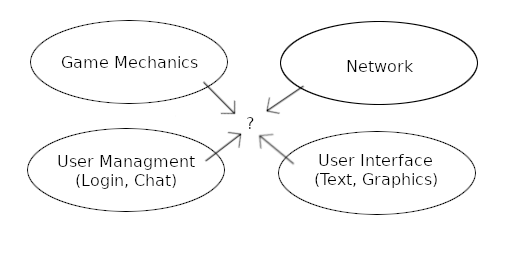

# ABOUT

SMP is a simple MUD engine, using PHP.

# TELNET NOTES

hex => decimal => char

fd06 => 253 006

0d0a => 013 010 => CR LF

# ARCHITECTURE

Overview of the components involved.

1. Do not overcomplicate.
2. Can be ported to C/C++.
3. What is the most important thing to concentrate on? Project Goals?

Prefer unsigned integer ids over UUIDs or other strings. Use UUIDs only for objects that need to be shared in a database or across application services.

# SMP

Simple MUD in PHP.

## Short Term Goals

1. Basic RPG - no particular setting yet.
2. Transient DB - everything is lost on restart.
3. Multiplayer obviously.
4. Concentrate more on software design.

## Renderer

Rendering the engine output to whatever frontend is used. For a MUD type game, it's text and then passed to the network layer.

Sometime into the future it can be a graphical frontend, which could be a combination of text and graphics, could be 2D could be 2.5D (3D with locked camera, isometric Diablo/Kenshi style).

## Ui

Ui class can have the user menu state? Or is it the game state? Should the state be stored in the Ui manager object, just like the password in the User manager? Map vs a user object member?

### Elements

User interface elements (or widgets, menus, windows, etc). See [List of GUI elements](https://en.wikipedia.org/wiki/List_of_graphical_user_interface_elements) for examples.

Login widget, which is a sequence of inputs. Finite state machine? No - use a stack.

Character creation widget (at first it should just be nickname). Same thing - use a stack.

## Input System

Input system has Text input class. How ill the network system feed text into the Text input class? Input system is basically the opposite of the Renderer system? (What? Opposite?) On the "left side" it should have the same access as the Render system (see diagram on real life notepad).

## User

At present, the Game class should be responsible for the player/user/client association.

A user id should be a temporary/in-memory identifier. The database id should be a UUID (or some other more robust unique identifier).

### States

The terms "player", "user", "client" are distinct. A user controls a player in game. Before a player is spawned in the game world and associated to a user, the user must first be authenticated. A client is (in this iteration of the engine) a network connection and should have a pretty straight forward connection to a user. A user is in the center of all three objects.

There are two main user states:

* Login
* In game

The difference is not associated with a game entity (player) and the latter is. This state should rarely change, per user.

### Manager

The User Manager must perform authentication & authorization, CRUD operations, temporary users (for login).

How will the transition of a temporary user to a logged in user be implemented?

## Systems Comms

Communication between (game engine) systems - how? Event queue or direct member calls? [Event Driven Comms - Yes or No?](https://gamedev.stackexchange.com/questions/7718/event-driven-communication-in-a-game-engine-yes-or-no)

What are the benefits of an event queue? User chat, in case of a graphical renderer. (what? user chat, what?) THere will be implicit queues, besides a dedicated event system. (Surely, it can't be one generic event queue for all systems? Performance?)

Fixed size arrays might be the way to go (if going with C/C++).

## Network

Currently, there are 3 incoming events:
	- New connection
	- Disconnect (forced, timeout)
	- Input

There are 2 outgoing events:
	- Logout (graceful connection closure)
	- Output

The network server will use events to notify registered handlers of connection state changes. Input/output are simpler operations that have only two properties (connection id and bytes). They don't need to be wrapped in an event object.

Have clients be identified by numeric ids, as opposed to some remote address strings.

## Game World

Composition vs inheritance? Perhaps shallow class hierarchies and lean on composition.

Any character should be playable. 
&nbsp;&nbsp;&nbsp;&nbsp;- Any sentient character is included (animals, mythical creatures, drones, etc).

**Logical hierarchy**

Universe &rarr; World / Planet / Large body &rarr; Continent / Region &rarr; ?Chunk?

**Physical hierarchy**

Only applies to universes? 
Different servers/DBs?

Universe, world, continent, & chunk **must** be entities.

Rooms **must** be entities.

## Entities

- Base class (abstract, interface) for all game objects, in the context of game mechanics, not sound, not FX, not textures, not mesh, etc.
- Use components? Gets too complicated? Inheritance can get troublesome.
- **Must** have a unique integer identifier.
	- Could be a serial id, assigned by a manger/factory class?
- **Must** have a name. It will be used as a machine/engine name. Different from a display label. It's more of a one line descriptor.
- *May* have a type. Could be an enum. Could just be the type of component. Limited to one type component per entity. Type component inheritance. This may have to be a **must**...
- *May* include UUID later on. May be beneficial for storage, in the context of a global DB.
- *May* have a display label. However, translation could make things complicated. The base entity should be simple.
- *May* have a display description. Same issues as the label. Looks like these are a component, but does it merit the extra resource?

Proposed fields: 
&nbsp;&nbsp;&nbsp;&nbsp;Required: 
&nbsp;&nbsp;&nbsp;&nbsp;&nbsp;&nbsp;&nbsp;&nbsp;Id: Int - unique identifier. 
&nbsp;&nbsp;&nbsp;&nbsp;&nbsp;&nbsp;&nbsp;&nbsp;~SerialId: Int - serial identifier.~ 
&nbsp;&nbsp;&nbsp;&nbsp;&nbsp;&nbsp;&nbsp;&nbsp;Name: String - machine name. 
&nbsp;&nbsp;&nbsp;&nbsp;Optional: 
&nbsp;&nbsp;&nbsp;&nbsp;&nbsp;&nbsp;&nbsp;&nbsp;Type: Enum/String/Object - Type of entity. 
&nbsp;&nbsp;&nbsp;&nbsp;&nbsp;&nbsp;&nbsp;&nbsp;Label: String - display label. 
&nbsp;&nbsp;&nbsp;&nbsp;&nbsp;&nbsp;&nbsp;&nbsp;Description: String - long text (longer than label) display description. 

## Types of Entities

### Containers

- Can contain other containers and, of course, other entities.
	- But containers are entities?
- Top level are universe, world, continent, chunk, room.
- *Should* the top container have a list to all containers of all types? Central authority? Perhaps the central authority is the universe manager/factory? This way container that is created can be tracked, regardless of where it is in the graph.
	- This implies one flat list, along with node connections (graph verts and edges).
- Hierarchy/Tree vs Graph
	- ~**Must** have only (1) parent?~ That's practically impossible. Does not make sense for rooms.
	- Can have zero (0) to many (N) children.
	- Research one vs many, parents type of graphs. Or are they jsut a tree vs a graph?
		- What was this note about? Doesn't make much sense.
	- Obviously, room connections will be represented as a graph(s).
	- At which point in the container hierarchy (what would be a good name?) a graph is contained?
		- Continent?
		- Chunk?

Rooms - type of container that has space... What is space? Can have coordinates? Wouldn't that be more of a chunk in 2+ dimensions? 
- Are universe,..., chunk rooms?
- *Should* "rooms" be called something else?

### Sentient

As opposed to non-sentient? Should there be such a distinction?

Anything that has a AI/Player controller?

TBD

### Mechanical

Doors, levers, retractable bridges, etc?

Can be controlled, but indirectly. I.e. a sentient controller acts on a mechanical entity.

May impact game physics, like the door cutting of access to a room, or maybe flooding a room with water.

(This is very much Dwarf Fortress like...)

### Items

Anything non-sentient and non-container?

TBD

### ?Static?

Furniture? Anything that can be interacted with, but is not mechanical.

A chest can be opened (interacted with) but does not change game physics.

What would be the benefit of having this be a distinct entity?

# Game Setting

Name: **Proxima**

The game setting is an implementation of a story, world in which the players will participate in.

The following describes a **single-player** game. Yes, this contradicts of the project's main game engine design goals. 
If a move to the full realization of the following game setting is ever done, it will be in a 2.5D type of game, carrying over some of the game design from the MUD. The MUD can still implement some of the game mechanics described in this section.

## Type

Far future, sci-fi, post-apocaliptyic, ruined empire. Game elements from Kenshi/StarSector/M&B.

**Open World** - no level restrictions, very much like Kenshi/Starsector. Player is responsible for their decisions (safety) and progression.

**No Instances** - Like in MMOs or some 

## Sentient Life

What will be the different sentient entity organizations?
- Nations, factions, corporations, guilds, clans, ad-hoc groups?
- Research the meaning of all the above terms.
- Have on neutral faction, that is the default. Does not mean, they're not attackable. (Kenshi like? What are the issues I had with Kenshi factions? Did I have any?)

Squads (like FTL? I never even played FTL... so maybe not). More like a random group of people can band together. Much like Kenshi. Howevere, having generic recruits/soldiers/employees like in StarSector/M&B should be included. Have expandable peons.
- "Squads" sounds weird. More like employees, personnel, just the people comprising player faction/clan/guild?
- Squads can board other ships, stations and other traversable SPACE objects, give the environment allows it.
- Environment includes SPACE weather (radiation, meteorites, etc.), topography (cliffs, canyons, etc.), chemical composition (acid, no oxygen).
	- Should aggressive macrobial life be a thing?
	- The "environment" should have its own section.
	- Could include resource gathering, base building in the far future development of the game... if that ever happens.

All NPCs are equally capable, relative to the player characters (Kenshi style). From a physics/game mechanics pov, no distinction between player/non-player characters.

Have drones. These are semi-sentient, more like narrow AI. Whoever controls them (and control can be easily swapped, by hacking for instance) sets their faction.

Player can do spacewalks and should, when going through derelicts/wreckage. Just have spacewalks when it makes sense.

## Environment

Avoid having planets be visitable (visit-able?). You can do this by having the planetary system be inhabitable (i.e. no habitable planets). Could have outposts on moons though?

Players can visit orbital space stations, big ships (that act as space stations), derelicts, wreckage, small asteroids, random points in space (player can chose to just stop somewhere along a travel path and do a spacewalk).

More TBD

## Vehicles

Have starships. But they're busted and all. Can work towards nice ones. The BMWs/Mercedes of spaceships.
- Realistic physics (orbital mechanics). Maybe something like The Expanse (TV series)?
- **No** custom in-game ship designs. Ship hulls are stock or provided by mods.
- Squads can be deployed to player piloted ship, only in the case of boarding by enemy ship.

Vehicles can be customized, but **not** their HULL. Pretty much like StarSector.

Could include land/small vehicles.

Keep variety of ships small. Lean on squad equipment and character.
